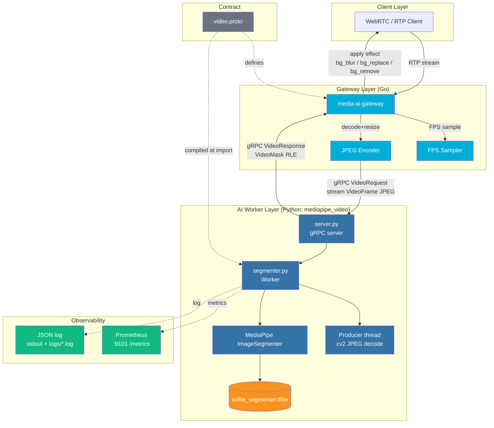
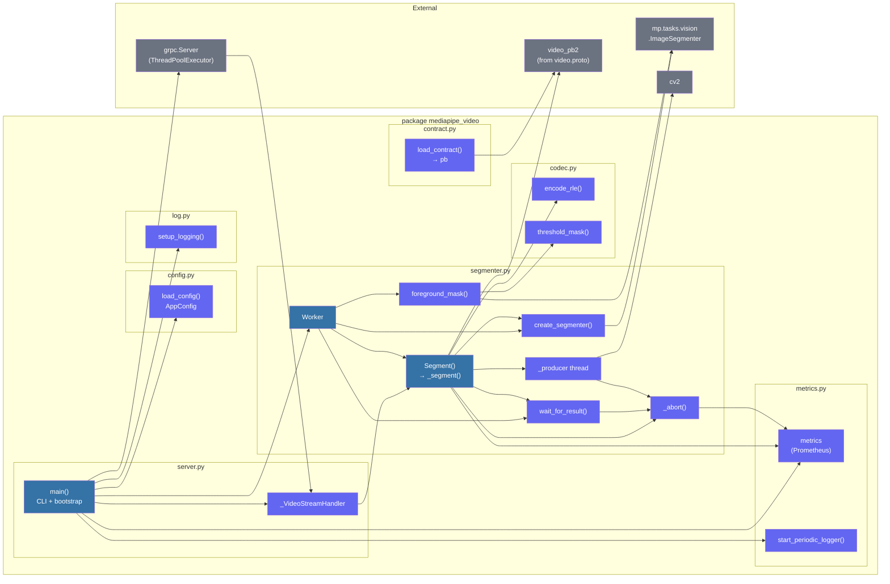
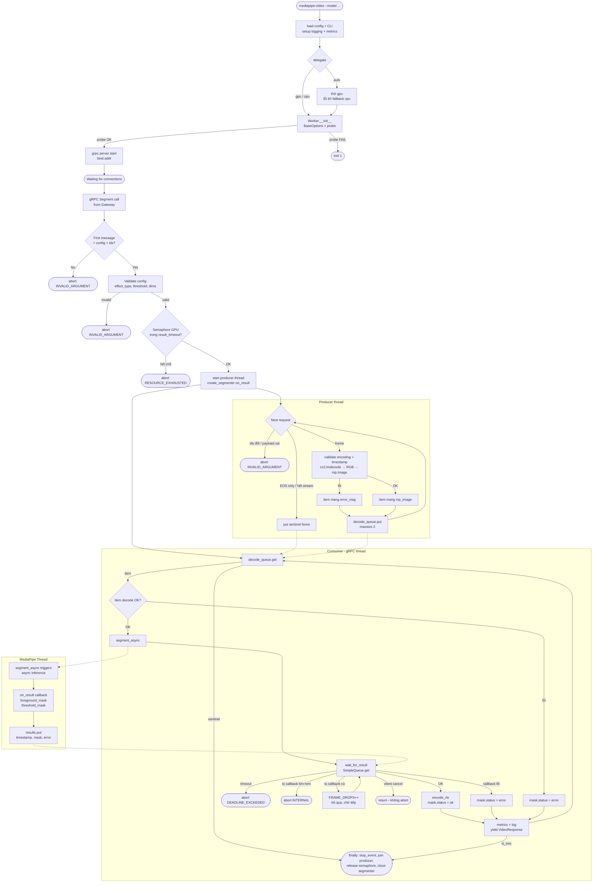
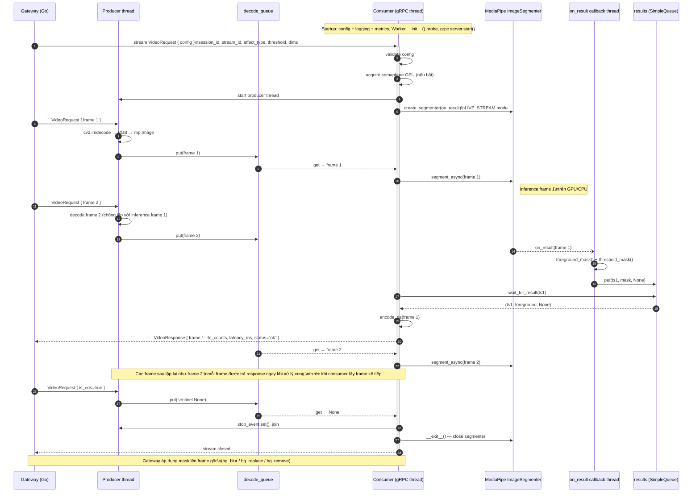

# MediaPipe Worker — Architecture Analysis

Cập nhật theo code: 2026-09-29 (v1.0.1)

---

## 1. Mô tả Project & Mục tiêu

**MediaPipe Worker** (package `mediapipe_video`) là một **Python microservice** thuộc hệ thống `media_ai_video`. Nó đóng vai trò là AI inference backend chuyên xử lý **video segmentation** theo thời gian thực — tách người (foreground) khỏi nền (background) trong từng video frame.

### Project này dùng để làm gì?

Worker nhận video frame liên tục qua **gRPC bidirectional streaming**, chạy model ML để tạo **segmentation mask**, rồi trả kết quả về cho gateway để áp dụng hiệu ứng:

- `bg_blur` — Làm mờ nền
- `bg_replace` — Thay nền bằng ảnh khác
- `bg_remove` — Xóa nền hoàn toàn (trong suốt)

Worker chỉ tạo mask; việc áp dụng hiệu ứng do Gateway thực hiện. Danh sách `effect_type` hợp lệ cấu hình được (`segmentation.allowed_effect_types`).

### Mục tiêu

1. **Tách biệt AI inference** khỏi gateway chính (Go) để scale độc lập
2. **Low-latency per-frame** — mỗi frame được xử lý và trả về ngay, không batch
3. **Hỗ trợ concurrent streams** — nhiều phiên video song song (`server.max_streams`, mặc định 8)
4. **Pluggable model** — đổi TFLite model mà không sửa code (`--model` / `mediapipe.model`)
5. **GPU/CPU switchable** — `delegate` = `gpu`, `cpu` hoặc `auto` (thử GPU, lỗi thì fallback CPU)
6. **Scale theo GPU** — mỗi process gắn một GPU (`gpu_device_index` → `CUDA_VISIBLE_DEVICES`); chạy N process cho N GPU, cân bằng tải bằng nginx (xem `docs/deployment.md`)
7. **Quan sát được** — Prometheus metrics và log JSON (xem `docs/metrics.md`)

---

## 2. Kiến trúc Tổng thể

MediaPipe Worker là **một node trong pipeline xử lý video** của hệ thống lớn hơn. Các thành phần chính:

| Lớp | Công nghệ | Vai trò |
|---|---|---|
| **Gateway** | Go | Tiếp nhận RTP stream, decode, resize, JPEG-encode, gửi qua gRPC |
| **MediaPipe Worker** | Python | Nhận JPEG frame, chạy inference, trả RLE mask |
| **TFLite Model** | `selfie_segmenter.tflite` | ML model chạy bên trong Worker |
| **Proto Contract** | `video.proto` | Định nghĩa giao tiếp giữa Gateway ↔ Worker |

### Vị trí trong hệ thống

```
Client (WebRTC/RTP)
        ↓
   Gateway (Go)
   ├── FPS sampling
   ├── Decode + Resize + JPEG encode
   └── gRPC stream → MediaPipe Worker (Python)
                         ├── Producer thread: đọc stream + JPEG decode (cv2)
                         ├── ImageSegmenter (LIVE_STREAM)
                         ├── TFLite model (GPU/CPU)
                         └── RLE mask → trả về Gateway
```

### Đặc điểm kiến trúc

- **Process boundary rõ ràng**: Gateway (Go) và Worker (Python) chạy trong 2 process riêng biệt, giao tiếp qua gRPC (mặc định `127.0.0.1:50052`)
- **Stateless per-stream**: Mỗi gRPC stream tạo một `ImageSegmenter`, `SimpleQueue`, `decode_queue` riêng; không chia sẻ state giữa các stream, ngoại trừ semaphore giới hạn GPU segmenter và các metric toàn cục
- **Contract-first**: `video.proto` là nguồn sự thật. Worker compile bản `src/mediapipe_video/video.proto` (đóng gói trong package) lúc import; bản gốc ở `src/proto/video.proto`. Hai bản phải giữ đồng bộ thủ công, và cần đồng bộ với file Gateway dùng
- **Producer–consumer trong từng stream**: một thread đọc + decode JPEG, một thread điều khiển GPU, nhờ đó decode frame kế tiếp chồng lấp với inference frame hiện tại
- **Một response cho mỗi frame, trả ngay**: consumer xử lý tuần tự từng frame (submit → chờ callback → RLE → yield), tối đa một frame trên GPU (LIVE_STREAM sẽ drop frame nếu submit chồng)
- **Async callback model**: MediaPipe LIVE_STREAM trả kết quả qua callback bất đồng bộ; Worker dùng `SimpleQueue` để đồng bộ về thread xử lý stream
- **Cấu hình 3 lớp**: mặc định trong dataclass < `etc/config.yaml` < CLI flag

---

## 3. Các Module Chính

Package `src/mediapipe_video/`:

| Module | Vai trò |
|---|---|
| `server.py` | Entry point (`main()`), CLI, gộp config, auto-detect delegate, đặt `CUDA_VISIBLE_DEVICES`, dựng gRPC server |
| `segmenter.py` | `Worker`: vòng đời `ImageSegmenter`, handler `Segment`, producer thread, `_abort()` |
| `codec.py` | `threshold_mask()`, `encode_rle()` |
| `config.py` | Dataclass config + `load_config()` (YAML) |
| `contract.py` | Compile `video.proto` lúc import → `pb` |
| `log.py` | JSON log formatter, rotate file theo ngày |
| `metrics.py` | Prometheus metrics, HTTP `/metrics`, log snapshot định kỳ |

### `server.main()` — Entry Point
Parse CLI, load config, setup logging và metrics, khởi tạo `Worker` (xử lý `delegate=auto`), dựng gRPC server, bind port, block đợi kết nối. Xử lý Ctrl+C bằng graceful stop.

### `contract.load_contract()` — Proto Loader
Compile `video.proto` tại runtime bằng `grpc_tools.protoc` vào thư mục tạm → import `video_pb2`. Kết quả gán vào biến module `pb`, được các module khác import.

### `Worker` class — Core Logic
Là trái tim của worker. Quản lý vòng đời của `ImageSegmenter` và xử lý từng gRPC stream.

| Method | Mô tả |
|---|---|
| `__init__(mp_config, seg_config)` | Đọc model, chọn delegate (`gpu`/`cpu`), tạo semaphore giới hạn segmenter, probe khởi động để vạch lỗi sớm |
| `create_segmenter(callback)` | Tạo `ImageSegmenter` mới với LIVE_STREAM mode và callback cụ thể |
| `foreground_mask(result, threshold)` | Lấy confidence plane từ MediaPipe result, ngưỡng thành binary mask |
| `wait_for_result(queue, ts, ctx)` | Block đợi callback, có timeout, kiểm tra cancel, bỏ callback cũ (đếm frame drop) |
| `Segment(requests, context)` | gRPC handler; bọc metric `ACTIVE_STREAMS` / `STREAMS_TOTAL`, ủy quyền cho `_segment()` |
| `_segment(requests, context)` | **Handler thật** — validate config, lấy semaphore, chạy producer thread, vòng consumer điều khiển GPU và yield response |

### `_abort(context, code, message)`
Tăng `stream_errors_total{reason}` rồi `context.abort()`. Mọi điểm abort đều đi qua hàm này để metric đầy đủ.

### `codec.encode_rle(mask)` — RLE Encoder
Chuyển binary numpy mask (HxW bool) thành danh sách số nguyên row-major RLE. Background = 0, foreground = 1; run đầu tiên luôn là background (có thể bằng 0).

### `codec.threshold_mask(probabilities, threshold)` — Mask Converter
Chuyển confidence float array (HxW hoặc HxWx1) thành boolean mask bằng cách so sánh với ngưỡng.

---

## 4. Luồng Hoạt động: Start → Shutdown

### Startup

1. `main()` parse CLI args (`--config`, `--addr`, `--model`, `--foreground-index`, `--gpu-device-index`, `--max-streams`, `--delegate`, `--result-timeout`, `--log-level`)
2. Load YAML (`--config` hoặc `etc/config.yaml` nếu tồn tại), CLI flag ghi đè giá trị YAML
3. `setup_logging()`; start Prometheus HTTP server (nếu `metrics.enabled`) và periodic metrics logger (nếu `log_interval_secs > 0`)
4. Validate: có `model` và file tồn tại, `max_streams > 0`, `result_timeout_secs` hữu hạn và dương
5. Nếu có `gpu_device_index` → `CUDA_VISIBLE_DEVICES` (trước khi tạo `Worker`)
6. `contract.py` đã compile `video.proto` lúc import module → `pb`
7. Tạo `Worker`; probe bằng cách tạo và đóng ngay 1 `ImageSegmenter`
   - `delegate=auto`: thử `gpu`, gặp `ValueError`/`RuntimeError` thì fallback `cpu`; cpu cũng lỗi thì thoát
   - `delegate` cố định mà lỗi thì thoát với thông báo
8. Cảnh báo nếu `delegate=gpu` mà `max_concurrent_segmenters=0`
9. `grpc.server(ThreadPoolExecutor(max_workers=max_streams), maximum_concurrent_rpcs=max_streams)`
10. Register handler `/video.VideoStream/Segment` → `worker.Segment`, `add_insecure_port(addr)`, `server.start()`
11. Log `server ready addr=… model=… mediapipe=… delegate=…` (JSON, trường `message`)
12. `server.wait_for_termination()` — block mãi

### Per-Stream (mỗi gRPC Segment call)

1. `Segment()` tăng `ACTIVE_STREAMS`, chuyển sang `_segment()`
2. Đọc message đầu tiên — phải là `config` có `session_id`, `stream_id`, không phải EOS; validate `effect_type`, `threshold` (0 → default), dimensions
3. Nếu bật giới hạn: lấy semaphore GPU (timeout `result_timeout`), hết chỗ → `RESOURCE_EXHAUSTED`
4. Tạo `results` (`SimpleQueue`), `decode_queue` (`Queue(maxsize=2)`), `stop_event`
5. Khởi động **producer thread**: đọc `requests`, validate từng message, decode JPEG bằng cv2 → RGB → `mp.Image`, đưa vào `decode_queue`; lỗi từng frame (encoding, timestamp, JPEG) được gắn vào item, không dừng stream
6. `create_segmenter(on_result)` — tạo `ImageSegmenter` dành riêng cho stream này
7. **Vòng consumer** (thread gRPC), mỗi lượt lấy một item từ `decode_queue` và xử lý trọn vẹn:
   - Decode OK: `segment_async()` → `wait_for_result()` → `encode_rle()`; decode lỗi hoặc callback lỗi: `mask.status="error"`
   - Cập nhật metric/log → `yield VideoResponse` ngay (đúng một response cho mỗi frame, không chờ frame kế tiếp)
8. Sentinel `None` (hết stream, EOS hoặc half-close) hoặc frame mang `is_eos=true` → thoát vòng lặp; không còn response nào chờ gửi
9. `finally`: `stop_event.set()`, xả `decode_queue`, `join` producer, thoát `with` (`ImageSegmenter.__exit__()`), release semaphore, `STREAMS_TOTAL++`, `ACTIVE_STREAMS--`

### Shutdown

- `KeyboardInterrupt` (Ctrl+C) → `server.stop(shutdown_grace_secs).wait()` (mặc định 2 giây cho stream hiện tại kết thúc). Không có handler riêng cho SIGTERM.

---

## 5. Thư viện Quan trọng & Dependency

### Thư viện chính

| Thư viện | Phần dùng | Vai trò |
|---|---|---|
| `mediapipe==0.10.35` | `mp.tasks.vision.ImageSegmenter`, `mp.Image` | ML inference engine, quản lý model TFLite |
| `grpcio==1.81.1` | `grpc.server`, `grpc.stream_stream_rpc_method_handler` | gRPC server runtime |
| `grpcio-tools==1.81.1` | `grpc_tools.protoc` | Compile `.proto` at runtime |
| `protobuf==6.33.6` | `video_pb2` (generated) | Serialize/deserialize protobuf messages |
| `numpy==2.4.6` | `np.frombuffer`, `np.flatnonzero`, `np.diff` | Buffer view, mask manipulation, RLE |
| `opencv-contrib-python>=4.5` | `cv2.imdecode`, `cv2.cvtColor` | JPEG decode, BGR → RGB |
| `PyYAML>=6.0` | `yaml.safe_load` | Đọc `config.yaml` |
| `prometheus-client>=0.20` | `Counter`, `Gauge`, `Histogram`, `start_http_server` | Metrics |
| `ruamel.yaml>=0.19` | (khai báo dependency, code chưa import) | — |

### Dependency giữa các module

```
server.main()
  ├── config.load_config()
  ├── log.setup_logging()
  ├── metrics (server + periodic logger)
  ├── contract.pb                → grpcio-tools, protobuf
  └── segmenter.Worker
       ├── create_segmenter()    → mediapipe
       ├── foreground_mask()     → codec.threshold_mask → numpy
       ├── wait_for_result()     → stdlib (queue, time), grpc, metrics
       └── Segment() / _segment()
            ├── producer thread  → opencv (cv2), numpy, mediapipe (mp.Image)
            ├── segment_async    → mediapipe
            ├── encode_rle()     → numpy
            └── metrics          → prometheus-client
```

### External dependencies (ngoài process)

- **`video.proto`** — đóng gói trong package (`src/mediapipe_video/video.proto`), bản gốc ở `src/proto/video.proto`
- **TFLite model file** — `--model` hoặc `mediapipe.model` (ví dụ: `checkpoint/selfie_segmenter.tflite`)
- **GPU driver** — cần EGL/OpenGL ES nếu chạy với `delegate=gpu` (hoặc `auto` muốn dùng GPU); trên RHEL 8 headless cần thêm thư viện X11 (xem `docs/deployment.md`)
- **File config** — `etc/config.yaml` (tùy chọn)

---

## 6. Architecture Diagram



### Triển khai multi-GPU

Mỗi process Worker gắn một GPU; nginx (stream proxy, `least_conn`) đứng trước để chia stream:

```
Gateway → nginx :50051 ──┬─► worker-0  CUDA_VISIBLE_DEVICES=0  :50052  metrics :9101
                         └─► worker-1  CUDA_VISIBLE_DEVICES=1  :50053  metrics :9102
```

Chi tiết cấu hình và lệnh chạy xem `docs/deployment.md`.

---

## 7. Module Diagram



---

## 8. Call Flow Diagram



---

## 9. Sequence Diagram


